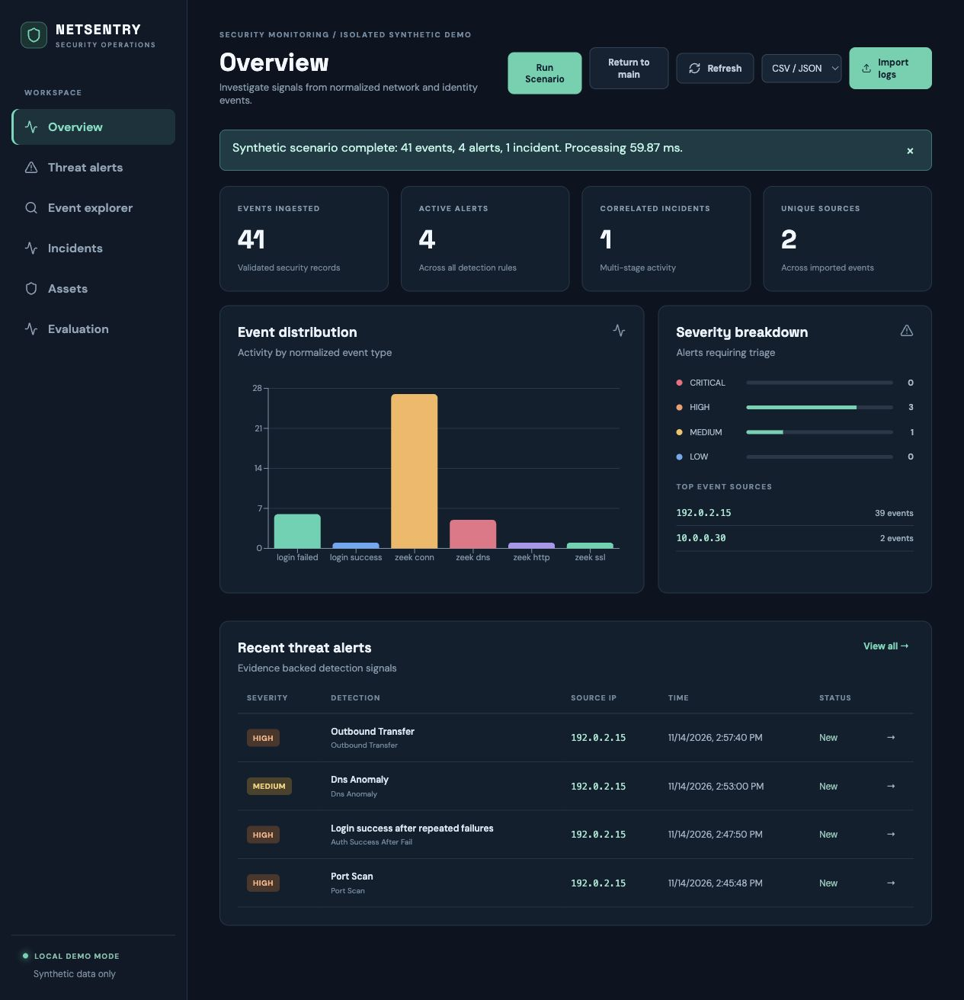
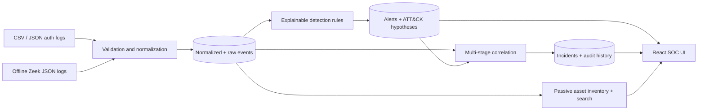

# NetSentry 2.0

A local-first **network threat detection and investigation prototype**. NetSentry imports offline Zeek JSON logs and authentication events, normalizes them into one event schema, runs explainable detections, and correlates a staged attack into an incident. It stores the original record and source provenance for investigation. It performs no live capture, scanning, blocking, or cloud upload.



**For a Guardsix application:** read the [application guide](docs/guardsix-application.md), then use the [verification report](docs/verification-report.md) and [security review](docs/security-review.md) to explain the engineering evidence and limits. This is an independent project, not a Guardsix product or integration.

## Run locally

Requires Python 3.11+ and Node.js 20+.

```bash
python3 -m venv .venv
.venv/bin/pip install -r backend/requirements.txt
cd backend && ../.venv/bin/uvicorn netsentry.main:app --reload
```

In another terminal:

```bash
cd frontend
npm ci
npm run dev
```

Open http://localhost:5173. The API is at http://localhost:8000/docs. Local Python uses SQLite in `backend/netsentry.db` by default.

### Docker Compose with PostgreSQL

```bash
docker compose up --build
```

Open http://localhost:8080. Compose binds the UI and API to `127.0.0.1` and stores PostgreSQL data in a named volume. The credentials in `compose.yaml` are **local demo credentials only**. `docker compose config --quiet` validates the configuration. Change the credentials and add authentication before any shared deployment. The project has no user login or role-based access control. This Compose stack was built and exercised locally with PostgreSQL, FastAPI, Nginx, and the synthetic one-click demo.

## One-click verification demo

Start the app, then click **Run Scenario**. NetSentry resets only its separate `netsentry-demo.db`, imports the bundled synthetic Zeek and authentication files through the normal pipeline, and opens the incident queue. Use **Return to main** to view your ordinary dataset. You can rerun the scenario without duplicating the incident. The demo reports parse, pipeline, detection, and correlation timings.

For manual import and a step-by-step explanation, use the workflow below. The staged logs are synthetic Zeek-shaped fixtures; `samples/zeek_official_conn.log` contains two attributed Zeek-generated examples used as a parser smoke test. See `samples/README.md`.

## Demonstrate the full attack chain

Choose the matching import format before each file:

1. Import `samples/zeek_conn.log` as **Zeek conn**. This contains 25 distinct-port connections, an internal remote-service connection, and a large outbound transfer.
2. Import `samples/zeek_dns.log` as **Zeek dns**.
3. Import `samples/zeek_http.log` as **Zeek http** and `samples/zeek_ssl.log` as **Zeek ssl**.
4. Import `samples/staged_auth.json` as **CSV / JSON**.
5. Open **Incidents**. One critical incident shows reconnaissance, authentication success after failures, possible lateral movement, and possible outbound transfer. Review event IDs and the timeline, assign an analyst, add a note, record a **simulated** response, and export JSON.
6. Open **Threat alerts** to inspect ATT&CK hypotheses and rule evidence. **Assets** shows observed IPs and their activity. **Evaluation** shows metrics from labelled synthetic cases.

The original `samples/security_events.json` and `.csv` remain supported. Exact repeated file imports are skipped by SHA-256 digest.

## Architecture



The local developer setup uses SQLite. Docker Compose uses PostgreSQL. No queue or worker is needed for the current bounded offline imports. See [architecture](docs/architecture.md) and [rule documentation](docs/detection-rules.md).

## Validation and evaluation

```bash
cd backend && ../.venv/bin/pytest -q
cd backend && ../.venv/bin/python -m scripts.evaluate
cd frontend && npm run build
```

The labelled corpus has 13 synthetic scenarios and nine positive rule labels. The generated [evaluation report](docs/detection-evaluation.json) reports **9 TP, 0 FP, 0 FN, 108 TN** across rule-scenario pairs, yielding precision, recall and F1 of 1.0 on this deliberately small corpus. These numbers verify the included fixtures and **do not predict real-world accuracy**. The report is regenerated by the command above. Four scenarios have no positive labels; the 108 true negatives count rule-scenario pairs, not 108 separate benign files. See [verification](docs/verification-report.md), [performance](docs/performance-benchmark.md), and [security review](docs/security-review.md). Actual app screenshots: [dashboard](docs/screenshots/dashboard.jpg), [incident investigation](docs/screenshots/incident-investigation.jpg), and [evaluation](docs/screenshots/evaluation.jpg).

## API highlights

| Method | Path | Purpose |
| --- | --- | --- |
| POST | `/api/ingest` | CSV or JSON events |
| POST | `/api/ingest/zeek/{conn,dns,http,ssl}` | Offline Zeek JSON lines |
| GET | `/api/events` | Search/filter events |
| GET | `/api/alerts` | Rule detections and ATT&CK mapping |
| GET/PATCH | `/api/incidents/{id}` | Incident investigation |
| POST | `/api/incidents/{id}/actions` | Audit a simulated response |
| GET | `/api/incidents/{id}/export` | Download JSON incident report |
| GET | `/api/assets` | Passive asset inventory |
| GET | `/api/evaluation` | Reproducible synthetic evaluation |
| GET | `/api/health`, `/api/ready` | Service checks |

## Portfolio wording

**NetSentry 2.0 - Network Threat Detection and Investigation Prototype | Python, FastAPI, Zeek logs, PostgreSQL/SQLite, React, TypeScript**

- Built a local-first security analytics pipeline for offline Zeek and authentication telemetry, with validated normalization, raw-event provenance, and explainable alerts.
- Correlated reconnaissance, authentication, remote-service activity, and large outbound transfer into an evidence-backed incident timeline with analyst workflow and audit history.
- Created a labelled synthetic evaluation corpus, automated integration tests, and a reproducible Docker Compose deployment.

Call this a **portfolio prototype**. Do not claim enterprise NDR, live monitoring, proven exfiltration, production RBAC, or real-world detection accuracy. ATT&CK mappings are investigation hypotheses; a large transfer does not prove data theft.

## Limitations

Imports are offline and limited to 2 MB / 10,000 rows per file. Detection re-evaluates stored history for affected source IPs on each import, so this is suited to small local datasets. Asset names and types are limited by observed metadata. Incident correlation keys mainly on source IP, with username and destination context for stages; shared NAT can confuse attribution. Minute-based alert fingerprints can merge nearby detections. The API has no authentication and is intended for a trusted local machine. The one-click demo uses a separate SQLite database and leaves the main database unchanged. See [architecture](docs/architecture.md) for further engineering tradeoffs.
